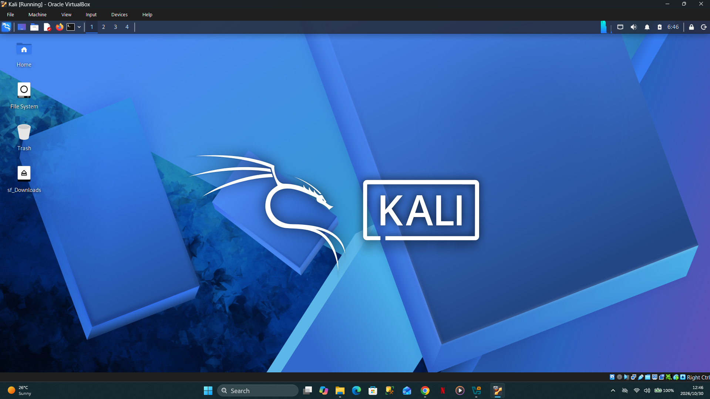

<div align="center">

# 🔐 Cybersecurity Lab Environment Setup

**A VirtualBox lab connecting Kali Linux, Windows 10 and Android 9**


</div>

---

## 📌 Project Overview

This project documents my **Networkwalks B084 — Week 1, Project Module 1** cybersecurity lab setup using Oracle VirtualBox.

I configured Kali Linux, Windows 10 and Android 9 on a shared **NAT Network**, checked their IPv4 settings, created and restored a Kali snapshot, and tested communication between the virtual machines.

The lab provides a foundation for future networking, reconnaissance and authorized security exercises. The screenshots below document the configuration and results achieved during this project.

---

## 🎯 Objectives

- Configure a dedicated VirtualBox NAT Network.
- Connect Kali Linux to the virtual network.
- Configure a shared folder between the host and Kali.
- Assign and verify Kali's IPv4 address.
- Create and restore a Kali baseline snapshot.
- Configure Windows 10 and confirm Android 9 network settings.
- Test gateway, external IP and inter-VM connectivity.
- Document the setup with screenshots and commands.

---

## 🏗️ Lab Architecture

All three virtual machines use the same IPv4 subnet and gateway.

| Machine | IPv4 address | Subnet mask | Default gateway | DNS configuration shown |
| --- | --- | --- | --- | --- |
| Kali Linux | `10.0.0.2` | `255.255.255.0` | `10.0.0.1` | `10.0.0.1` |
| Android 9 | `10.0.0.9` | `255.255.255.0` | `10.0.0.1` | `8.8.8.8`, `10.0.0.1` |
| Windows 10 | `10.0.0.10` | `255.255.255.0` | `10.0.0.1` | Preferred: `8.8.8.8`; alternate: `10.0.0.1` |

The NAT Network supports communication between the lab VMs and outbound connectivity through the host. It is **not an air-gapped environment**.

---

## ⚙️ Lab Configuration

| Component | Configuration documented |
| --- | --- |
| Hypervisor | Oracle VirtualBox |
| Virtual machines | Kali Linux, Windows 10, Android 9 |
| Virtual network name | `Virtual NAT Network` |
| Network mode | NAT Network |
| IPv4 prefix | `10.0.0.0/24` |
| DHCP | Enabled on the NAT Network |
| IPv6 | Enable IPv6 checkbox unchecked |
| Kali adapter | Intel PRO/1000 MT Desktop (82540EM) |
| Kali promiscuous mode | Allow All |
| Kali virtual cable | Connected |
| Kali IPv4 method | Manual |
| Shared folder | Host Downloads folder; full access; auto-mount enabled |
| Snapshot name | `Snapshot 1` |
| Snapshot description | `Clean Kali Linux Ip addressing` |

Exact VirtualBox and Kali release versions, host hardware specifications and VM resource allocations are not established by the screenshots.

---

# 🪜 Lab Setup Procedure

## Step 1. Create the NAT Network

In VirtualBox Network Manager, I configured a NAT Network with the following settings:

```text
Network name: Virtual NAT Network
IPv4 prefix:  10.0.0.0/24
DHCP:         Enabled
IPv6:         Disabled
```

This network provides a common subnet for the three lab machines.


---

## Step 2. Connect Kali to the NAT Network

I enabled Kali's first network adapter and attached it to the configured NAT Network.

```text
Adapter:          Adapter 1
Attached to:      NAT Network
Name:             Virtual NAT Network
Adapter type:     Intel PRO/1000 MT Desktop (82540EM)
Promiscuous mode: Allow All
Virtual cable:    Connected
```


---

## Step 3. Configure the Shared Folder

I configured the host Downloads folder as a VirtualBox shared folder with **full access** and **auto-mount** enabled. The Kali desktop also shows the mounted `sf_Downloads` folder.

This provides a way to transfer lab files between the host and Kali. Because it permits access to host files, a dedicated lab-only folder with limited permissions would reduce exposure during future testing.


---

## Step 4. Start Kali Linux

I started the Kali VM and confirmed that the desktop loaded successfully.



---

## Step 5. Configure Kali's IPv4 Settings

Using **Wired connection 1 → IPv4 Settings**, I selected the manual addressing method and entered:

```text
IP address:    10.0.0.2
Prefix length: 24
Subnet mask:   255.255.255.0
Gateway:       10.0.0.1
DNS server:    10.0.0.1
```

A consistent address makes Kali easier to identify during subsequent lab exercises.


### Verify the Address

I checked the active interface using:

```bash
ifconfig
```

The output shows `eth0` with IPv4 address `10.0.0.2`, subnet mask `255.255.255.0` and broadcast address `10.0.0.255`.


---

## Step 6. Create a Kali Baseline Snapshot

After configuring Kali's address, I created a snapshot to preserve the configured VM state.

```text
Snapshot name:        Snapshot 1
Snapshot description: Clean Kali Linux Ip addressing
```


The next screenshot shows the snapshot operation in progress.


---

## Step 7. Restore the Snapshot

I selected the saved snapshot in VirtualBox and used the **Restore** option.


The following screenshot records the resulting snapshot view with Kali in a saved state. A later connectivity screenshot shows Kali running as `Kali (Snapshot 1)` and retaining `10.0.0.2`.


---

## Step 8. Confirm Android 9 Network Settings

The Android network details show the following configuration:

```text
IP address:  10.0.0.9
Subnet mask: 255.255.255.0
Gateway:     10.0.0.1
DNS servers: 8.8.8.8, 10.0.0.1
```


---

## Step 9. Configure Windows 10 IPv4 Settings

In the Windows Ethernet IPv4 properties, I configured:

```text
IP address:    10.0.0.10
Subnet mask:   255.255.255.0
Gateway:       10.0.0.1
Preferred DNS: 8.8.8.8
Alternate DNS: 10.0.0.1
```


---

# 🔎 Lab Verification

## Android 9 Connectivity Tests

From the Android terminal, I tested an external IP, the gateway, Kali and Windows:

```bash
ping -c 4 8.8.8.8
ping -c 4 10.0.0.1
ping -c 4 10.0.0.2
ping -c 4 10.0.0.10
```

The external IP, gateway and Kali tests each returned four replies with **0% packet loss**. The initial Windows test failed; a repeated test returned four replies with **0% packet loss**.


## Windows 10 Connectivity Tests

I checked the Windows configuration with:

```cmd
ipconfig /all
```

I then ran:

```cmd
ping 10.0.0.10
ping 8.8.8.8
ping 10.0.0.1
ping 10.0.0.9
```

The screenshot confirms the configured address and DNS servers. All four displayed ping tests completed with **0% packet loss**. The ping to `10.0.0.10` is a self-test; the ping to `10.0.0.9` verifies communication with Android. A Windows-to-Kali ping is not shown.


## Kali Linux Connectivity Tests

From Kali, I verified the interface address and tested the gateway, external IP, Android and Windows:

```bash
ifconfig
ping -c 6 10.0.0.1
ping -c 6 8.8.8.8
ping -c 10 10.0.0.9
ping -c 10 10.0.0.10
```

All displayed ping tests completed with **0% packet loss**.


### ✅ Results Summary

| Source | Destination | Recorded result |
| --- | --- | --- |
| Android 9 | External IP `8.8.8.8` | 4/4 replies; 0% loss |
| Android 9 | Gateway `10.0.0.1` | 4/4 replies; 0% loss |
| Android 9 | Kali `10.0.0.2` | 4/4 replies; 0% loss |
| Android 9 | Windows `10.0.0.10` | Initial failure; retry 4/4 replies, 0% loss |
| Windows 10 | Own address `10.0.0.10` | 4/4 replies; 0% loss |
| Windows 10 | External IP `8.8.8.8` | 4/4 replies; 0% loss |
| Windows 10 | Gateway `10.0.0.1` | 4/4 replies; 0% loss |
| Windows 10 | Android `10.0.0.9` | 4/4 replies; 0% loss |
| Kali Linux | Gateway `10.0.0.1` | 6/6 replies; 0% loss |
| Kali Linux | External IP `8.8.8.8` | 6/6 replies; 0% loss |
| Kali Linux | Android `10.0.0.9` | 10/10 replies; 0% loss |
| Kali Linux | Windows `10.0.0.10` | 10/10 replies; 0% loss |

**Verification scope:** Pinging `8.8.8.8` demonstrates external IP reachability. These screenshots do not establish DNS resolution or access to web services.

---

# 🐞 Observation & Troubleshooting

## Initial Android-to-Windows Ping Failure

The first Android ping to `10.0.0.10` recorded four transmitted packets with no replies. Repeating the command later produced four replies with no packet loss.

The screenshots document the failure and successful retry, but do not establish the cause or any configuration change made between attempts.

For a similar issue, useful checks include confirming that the destination VM is running, both adapters use the same NAT Network, the IP settings are correct, and the destination firewall permits the intended ICMP test.

---

# 💡 What I Learned

- **Virtual networking:** A shared NAT Network can connect multiple VMs while providing outbound connectivity.
- **IPv4 addressing:** Each VM needs a unique address, the correct subnet mask and a suitable gateway.
- **Cross-platform verification:** Linux and Android use terminal tools such as `ifconfig` and `ping`; Windows provides `ipconfig /all` and `ping`.
- **Snapshots:** Saving and restoring a baseline supports repeatable lab exercises and recovery.
- **Troubleshooting:** A failed ping is an observation to investigate; a later successful test alone does not explain its cause.
- **Evidence-based documentation:** Configuration screenshots and command output help distinguish completed checks from future work.

---

# 🔐 Security & Ethical Use

This lab is intended for education and authorized testing of systems I own or have explicit permission to assess.

NAT connectivity and shared folders do not provide complete isolation. For future exercises involving untrusted software, I would review outbound access, shared folders and adapter permissions before starting.

---

# 🚀 Future Improvements

- Verify DNS resolution using a domain lookup.
- Record a Windows-to-Kali connectivity test.
- Document exact software versions and VM resource allocations.
- Review DHCP allocation ranges to prevent overlap with manually assigned addresses.
- Create baseline snapshots for Windows and Android.
- Use a dedicated shared folder with only the permissions needed for each exercise.

---

# 🔗 Tools & References

- **Oracle VirtualBox:** https://virtualbox.org/wiki/Downloads
- **Kali Linux:**  https://kali.org/get-kali
- **Windows:** https://www.microsoft.com/software-download/windows10
- **Android:** https://sourceforge.net/projects/android-x86/files/Release%209.0/


---

# 👤 Project Owner
**Mokone Tebogo**

LinkedIn: (https://www.linkedin.com/in/tebogo-mokone-ba2b35261/)

---

**Programme:** Cybersecurity at Networkwalks | **Cohort:** B084 | **Week:** 01 | **Module:** PM1 — Cybersecurity Lab Setup | **Repository:** GitHub
